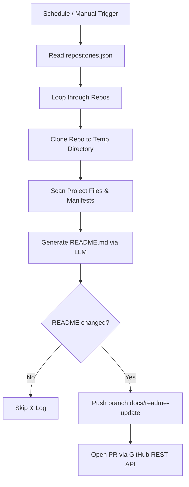

# Centralized Documentation Orchestrator

This repository functions as a centralized documentation steward. It automatically monitors, scans, and submits documentation updates (via Pull Requests) for all your configured GitHub repositories.

By running this orchestrator on a schedule, you eliminate the need to maintain separate agentic workflow files in every single one of your repositories.

## How It Works



## Repository Structure

- `repositories.json`: Config file listing the repository paths (`owner/repo-name`) to monitor.
- `orchestrator.py`: The Python engine which clones, scans, runs the LLM, and creates the PR.
- `requirements.txt`: Python package dependencies.
- `.github/workflows/documentation-orchestrator.yml`: Scheduled GitHub Actions workflow.

---

## Setup Instructions

### 1. Configure Target Repositories
Add your repositories to `repositories.json` as a JSON array:
```json
[
  "your-github-username/my-first-project",
  "your-github-username/my-second-project"
]
```

### 2. Configure GitHub Secrets in this Repo
Go to **Settings** ➔ **Secrets and variables** ➔ **Actions** in this orchestrator repository and add:

| Secret Name | Description | Scope |
|-------------|-------------|-------|
| `ORCHESTRATOR_PAT` | Personal Access Token (PAT) with `repo` scope | Required (so the runner can push branches and open PRs on target repos) |
| `GEMINI_API_KEY` | Google AI Studio API Key | Required if using Gemini |
| `ANTHROPIC_API_KEY`| Anthropic Console API Key | Required if using Claude |

> [!IMPORTANT]
> A custom PAT is required because the default `GITHUB_TOKEN` provided to actions cannot authenticate operations on other repositories.

### 3. Choose your LLM Provider
The workflow will automatically auto-detect which API key is provided:
- If `GEMINI_API_KEY` is present, it uses Gemini (`gemini-1.5-flash`).
- If `ANTHROPIC_API_KEY` is present, it uses Claude (`claude-3-5-sonnet-20241022`).

---

## Local Verification & Development

You can run the orchestrator locally to test it before pushing to GitHub.

### Setup environment:
```bash
# Install dependencies
pip install -r requirements.txt

# Export your credentials
export ORCHESTRATOR_PAT="your-github-token"
export GEMINI_API_KEY="your-gemini-key" # OR ANTHROPIC_API_KEY="your-claude-key"
```

### Run in Dry-Run Mode (Recommended for testing)
Runs the scan and displays the generated README in your terminal *without* committing, pushing, or opening any Pull Requests:
```bash
python orchestrator.py --dry-run
```

### Run live update (force specific provider)
```bash
python orchestrator.py --provider gemini
```
